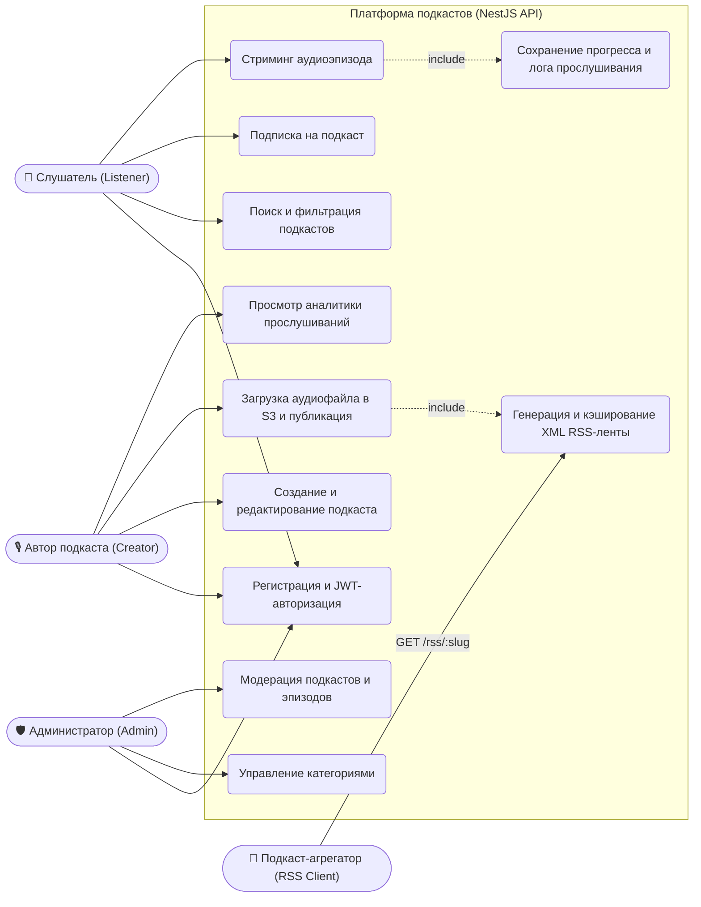
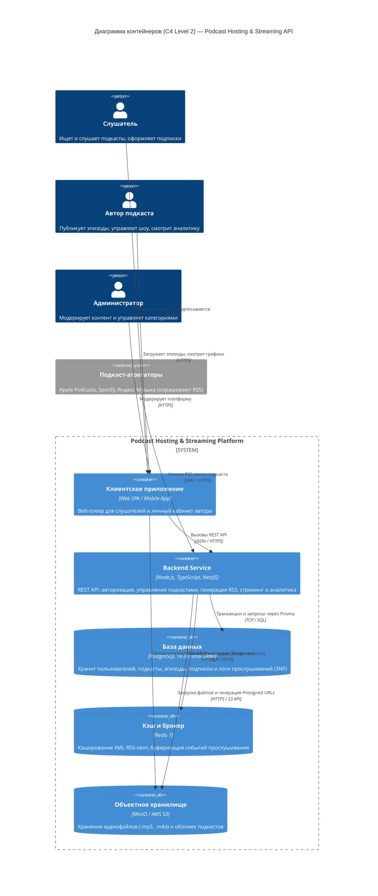
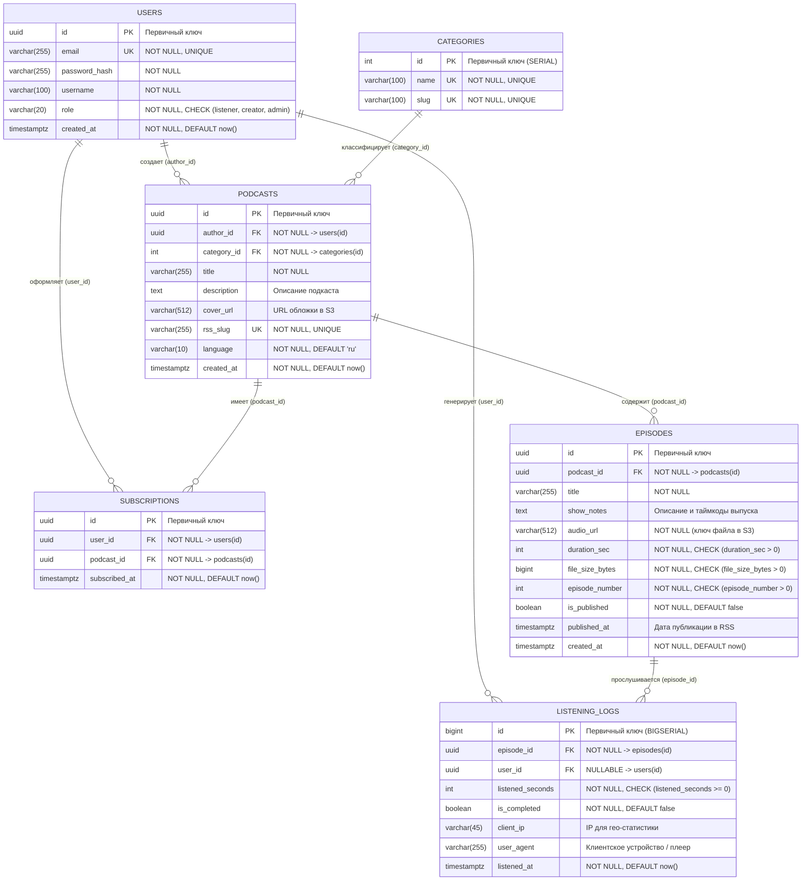

# Архитектура проекта: Podcast Hosting & Streaming API (Вариант №22)

## 1. Описание проекта
**Podcast Hosting & Streaming API** — серверное приложение для хостинга подкастов, загрузки и потоковой раздачи аудиоэпизодов, автоматической генерации XML RSS-лент для подкаст-агрегаторов (Apple Podcasts, Spotify, Яндекс Музыка) и сбора детальной аналитики прослушиваний.

---

## 2. Стек технологий

| Компонент | Технология | Назначение в проекте |
|---|---|---|
| **Язык и платформа** | Node.js (LTS) + TypeScript 5 | Строгая типизация, асинхронный ввод-вывод и нативная работа с аудиопотоками (`Streams`) |
| **Backend-фреймворк** | NestJS | Модульная слоистая архитектура (`Controller -> Service -> Repository`), DI, валидация (`class-validator`), автогенерация Swagger (`@nestjs/swagger`) |
| **Основная СУБД** | PostgreSQL 16 | Реляционное хранение данных пользователей, подкастов, эпизодов, подписок и логов в 3NF |
| **ORM и миграции** | Prisma ORM | Типобезопасные запросы к БД и декларативное управление миграциями (`schema.prisma`) |
| **Кэш и очереди** | Redis 7 + BullMQ | Кэширование сгенерированных RSS-лент, буферизация счетчиков прослушиваний и фоновые задачи |
| **Объектное хранилище** | MinIO / AWS S3 (`@aws-sdk/client-s3`) | Хранение аудиофайлов (`.mp3`, `.m4a`) и обложек, выдача Presigned URLs и стриминг |
| **Безопасность** | Passport.js + JWT + bcrypt | Аутентификация (Access/Refresh токены) и ролевая авторизация (`RolesGuard`) |
| **Инфраструктура** | Docker + Docker Compose | Контейнеризация приложения, PostgreSQL, Redis и MinIO |

---

## 3. Ролевая модель и сценарии использования (Use Cases)

### Слушатель (Listener)
* Регистрация, авторизация и управление профилем.
* Поиск подкастов по категориям, авторам и ключевым словам.
* Оформление подписки на подкасты и доступ к RSS-ленте.
* Потоковое прослушивание (стриминг) аудиоэпизодов с поддержкой перемотки (`HTTP Range requests`) и сохранением прогресса.

### Автор подкаста (Creator)
* Создание и настройка собственных подкастов (название, описание, обложка, категория, язык).
* Загрузка аудиофайлов в S3-хранилище и публикация эпизодов.
* Управление метаданными выпусков (таймкоды/шоу-ноты, номер выпуска, статус публикации).
* Автоматическая генерация и инвалидация кэша RSS-ленты при публикации новых выпусков.
* Просмотр статистики прослушиваний (общее число прослушиваний, уникальные слушатели, дослушиваемость, устройства и география).

### Администратор (Admin)
* Управление справочником категорий подкастов.
* Модерация контента (блокировка подкастов и эпизодов при нарушении правил).
* Управление пользователями и ролями.

### Диаграмма прецедентов (Use Case Diagram)




---

## 4. Ключевые сущности предметной области (Domain Model)

1. `users` — учетные записи пользователей (`listener`, `creator`, `admin`).
2. `categories` — справочник тематических категорий подкастов.
3. `podcasts` — шоу (подкасты), создаваемые авторами.
4. `episodes` — аудиовыпуски подкаста с метаданными и ссылкой на файл в S3.
5. `subscriptions` — связующая таблица подписок слушателей на подкасты.
6. `listening_logs` — таблица фактов (событий) прослушиваний для аналитики и трекинга прогресса.

---

## 5. Диаграмма C4 Container (Уровень 2)




---

## 6. ER-диаграмма базы данных (3NF)

Схема БД спроектирована в 3-й нормальной форме (3NF): все поля атомарны (1NF), зависят от полного первичного ключа (2NF), и отсутствуют транзитивные зависимости между неключевыми атрибутами (3NF).




### Ограничения целостности и индексы
* **Первичные ключи (PK):** `UUID` для таблиц `users`, `podcasts`, `episodes`, `subscriptions`; `BIGINT` для высоконагруженного журнала `listening_logs`; `INT` для справочника `categories`.
* **Внешние ключи (FK):**
  * `podcasts.author_id -> users.id (ON DELETE CASCADE)`
  * `podcasts.category_id -> categories.id (ON DELETE RESTRICT)`
  * `episodes.podcast_id -> podcasts.id (ON DELETE CASCADE)`
  * `subscriptions.user_id -> users.id (ON DELETE CASCADE)`
  * `subscriptions.podcast_id -> podcasts.id (ON DELETE CASCADE)`
  * `listening_logs.episode_id -> episodes.id (ON DELETE CASCADE)`
  * `listening_logs.user_id -> users.id (ON DELETE SET NULL)`
* **Ограничения (Constraints):**
  * `UNIQUE (user_id, podcast_id)` в `subscriptions` — защита от повторной подписки на один и тот же подкаст.
  * `CHECK (duration_sec > 0)` и `CHECK (file_size_bytes > 0)` в `episodes`.
  * `CHECK (role IN ('listener', 'creator', 'admin'))` в `users`.
* **Индексы (Indexes):**
  * `idx_podcasts_author_id` на `podcasts(author_id)`
  * `idx_podcasts_category_id` на `podcasts(category_id)`
  * `idx_episodes_podcast_pub` на `episodes(podcast_id, is_published, published_at DESC)` — ускоряет генерацию RSS-ленты и выборку опубликованных эпизодов.
  * `idx_listening_logs_episode_date` на `listening_logs(episode_id, listened_at)` — ускоряет построение отчетов аналитики для автора.
---

## 7. Спецификация REST API (REST API Specs)

Полная спецификация в формате OpenAPI 3.0.3 находится в файле **[openapi.yaml](./openapi.yaml)**.

| Метод | URI | Описание | Доступ (роль) | Ожидаемый код |
|---|---|---|---|---|
| POST | `/api/v1/auth/register` | Регистрация пользователя | Все | `201 Created` |
| POST | `/api/v1/auth/login` | Вход и выдача JWT | Все | `200 OK` |
| GET | `/api/v1/podcasts` | Список и поиск подкастов | Все | `200 OK` |
| POST | `/api/v1/podcasts` | Создать новый подкаст | Автор / Админ | `201 Created` |
| GET | `/api/v1/podcasts/{id}` | Детали подкаста | Все | `200 OK` |
| PATCH | `/api/v1/podcasts/{id}` | Обновить описание подкаста | Владелец / Админ | `200 OK` |
| DELETE | `/api/v1/podcasts/{id}` | Удалить подкаст | Владелец / Админ | `204 No Content` |
| POST | `/api/v1/podcasts/{id}/episodes` | Загрузить новый эпизод | Владелец (Автор) | `201 Created` |
| GET | `/api/v1/podcasts/{id}/rss` | RSS-лента эпизодов (XML) | Все / Агрегаторы | `200 OK` |
| POST | `/api/v1/episodes/{id}/listen` | Записать прогресс и лог | Слушатель / Все | `201 Created` |
| GET | `/api/v1/podcasts/{id}/stats` | Статистика прослушиваний | Владелец / Админ | `200 OK` |
| POST | `/api/v1/subscriptions` | Подписаться на подкаст | Слушатель | `201 Created` |
| DELETE | `/api/v1/subscriptions/{id}` | Отменить подписку | Владелец подписки | `204 No Content` |
---

## 8. Реализация базового каркаса (Лабораторная работа №3)

### 1. Организация структуры каталогов (Layered Architecture)
Исходный код серверного приложения организован по принципам слоистой архитектуры (Separation of Concerns):
- `cmd/app/` — точка входа в приложение (`index.ts`), инициализация DI-контейнера и запуск HTTP-сервера.
- `internal/config/` — модуль загрузки конфигурации и переменных окружения из файла `.env`.
- `internal/controller/` — слой представления (Transport / HTTP Handlers), принимающий запросы (`GET /api/v1/health`).
- `internal/service/` — слой бизнес-логики (Business Logic Layer), обрабатывающий сценарии работы.
- `internal/repository/` — слой работы с данными (Data Access Layer) и системными метриками.

### 2. Конфигурация окружения
- Конфигурационные параметры вынесены в файл `.env`, который исключен из системы контроля версий через `.gitignore`.
- В репозиторий добавлен шаблон безопасных настроек **`.env.example`**.

### 3. Реализация Health-check эндпоинта
- **Метод и URI:** `GET /api/v1/health`
- **Код ответа:** `200 OK`
- **Формат ответа (JSON):**
  ```json
  {
    "status": "pass",
    "app_name": "Podcast Hosting & Streaming API",
    "version": "1.0.0",
    "environment": "development",
    "uptime_seconds": 45,
    "timestamp": "2026-11-16T12:00:00.000Z"
  }
## 9. Контейнеризация приложения (Лабораторная работа №4)

### 1. Оптимизация контекста сборки (`.dockerignore`)
В корень проекта добавлен файл `.dockerignore`, исключающий локальные зависимости (`node_modules/`), артефакты сборки (`dist/`), файлы окружения (`.env`), историю Git (`.git`) и документацию из контекста сборки Docker-образа.

### 2. Многоэтапная сборка (`Dockerfile`)
Для минимизации размера итогового образа и повышения безопасности применен подход **Multi-stage build** на базе легковесного образа `node:20-alpine`:
1. **Этап `builder`:** копирует `package*.json`, устанавливает все зависимости (`npm ci`), копирует исходный код TypeScript (`cmd/`, `internal/`) и компилирует его в JavaScript (`npm run build` -> `./dist`).
2. **Финальный этап (`runner`):** использует чистый образ `node:20-alpine`, устанавливает только production-зависимости (`npm ci --only=production`) и копирует скомпилированные файлы из этапа `builder`. Исходный код `.ts` и компилятор TypeScript в финальный образ не попадают.

### 3. Сборка и запуск контейнера
- **Сборка образа:** `docker build -t podcast-platform-api:latest .`
- **Запуск контейнера:** `docker run --name podcast-api-container -d -p 3000:3000 -e HTTP_PORT=3000 podcast-platform-api:latest`
- **Проверка работоспособности:** `GET http://localhost:3000/api/v1/health` (`200 OK`).

---

## 10. Интеграция с PostgreSQL, миграции и Docker Compose (Лабораторная работа №5)

### 1. Версионируемые SQL-миграции (`migrations/`)
На основе ER-диаграммы из 3NF созданы миграции для инструмента `golang-migrate` (`migrate/migrate:v4.18.1`):
- `migrations/000001_init_schema.up.sql` — создание таблиц `users`, `categories`, `podcasts`, `episodes`, `subscriptions` и `listening_logs` с ограничениями целостности (`PRIMARY KEY`, `FOREIGN KEY` с правилами `ON DELETE CASCADE`, `RESTRICT`, `SET NULL`, `NOT NULL`, `UNIQUE`, `CHECK`) и индексами на внешних ключах и часто запрашиваемых полях.
- `migrations/000001_init_schema.down.sql` — откат схемы базы данных с удалением таблиц в порядке, обратном созданию.

### 2. Конфигурация и безопасность переменных окружения
- Параметры подключения к СУБД (`DB_HOST`, `DB_PORT`, `DB_USER`, `DB_PASSWORD`, `DB_NAME`, `DB_MAX_CONNS`) и настройки портов (`DB_HOST_PORT=5433`, `HTTP_PORT=3000`) считываются из переменных окружения.
- Модуль конфигурации проверяет наличие обязательных параметров при старте и завершает работу с понятным сообщением об ошибке при отсутствии необходимых переменных.
- Файл `.env` исключён из Git через `.gitignore`, а в репозитории хранится шаблон `.env.example`.

### 3. Оркестрация сервисов (`docker-compose.yml`)
Инфраструктура описана в `docker-compose.yml` и включает три сервиса в общей сети:
- `db` (`postgres:16-alpine`) — база данных с именованным томом `pgdata` (`/var/lib/postgresql/data`) для сохранения данных между перезапусками и проверкой готовности `healthcheck` (`pg_isready`).
- `migrate` (`migrate/migrate:v4.18.1`) — контейнер применения миграций, запускающийся после перехода `db` в состояние `service_healthy`.
- `app` — контейнер серверного приложения, стартующий после успешного завершения миграций (`service_completed_successfully`).

### 4. Пул соединений и проверка доступности БД (`/health`)
- Подключение к PostgreSQL реализовано через пул соединений (`pg.Pool`) с ограничением максимального числа подключений (`DB_MAX_CONNS`) и механизмом повторных попыток (`retry`) при старте приложения.
- Эндпоинт `GET /health` (и `GET /api/v1/health`) проверяет состояние соединения с базой данных: возвращает `200 OK` (`{"status":"ok","db":"up",...}`) при доступной БД и `503 Service Unavailable` (`{"status":"unavailable","db":"down",...}`) при недоступной СУБД.

---

## 11. Реализация слоя доступа к данным — паттерн Repository (Лабораторная работа №6)

### 1. Доменные модели и доменные ошибки (`internal/domain/`)
- Описаны доменные модели (`User`, `Podcast`, `Subscription`), соответствующие столбцам таблиц схемы БД из 3NF.
- Конфиденциальные данные (например, `passwordHash`) не сериализуются в JSON-ответы.
- Объявлены доменные ошибки `ErrNotFound`, `ErrAlreadyExists`, `ErrConflict` и `ErrInvalidInput`[cite: 18].

### 2. Интерфейсы репозиториев (`internal/repository/repository.ts`)
- Интерфейсы репозиториев выделены отдельно от конкретной реализации PostgreSQL.
- Реализованы контракты с методами `create`, `getByID`, `list(limit, offset)` и `delete`, а также дополнительные методы `getByEmail` (для пользователей) и `update` (для подкастов).

### 3. Реализация для PostgreSQL и маппинг ошибок (`internal/repository/postgres/`)
- Все запросы к PostgreSQL выполняются исключительно как параметризованные (`$1`, `$2`, ...) с явным перечислением столбцов вместо `SELECT *`[cite: 17].
- В методах `list` задана однозначная сортировка (`ORDER BY created_at DESC, id` / `subscribed_at DESC, id`) и ограничена верхняя граница `limit`[cite: 18].
- В методах `update` и `delete` проверяется количество затронутых строк (`rowCount === 0` преобразуется в `ErrNotFound`)[cite: 18].
- Коды ошибок СУБД (`SQLSTATE` / `err.code` в `pg`) преобразуются в доменные ошибки: `23505` → `ErrAlreadyExists`, `23503` → `ErrConflict`, `23514` и `22P02` → `ErrInvalidInput`[cite: 18].

### 4. Интеграционные тесты (`internal/repository/postgres/repo.integration.spec.ts`)
- Настроена отдельная тестовая база данных `podcast_test` с применёнными миграциями.
- Написаны интеграционные тесты на Jest (`ts-jest`), проверяющие создание и чтение записи с автогенерацией идентификатора и даты создания в СУБД, обработку дубликата уникального поля (`ErrAlreadyExists`), чтение несуществующей записи (`ErrNotFound`), пагинацию по `limit`, удаление и защиту от SQL-инъекций в `getByEmail`[cite: 17].